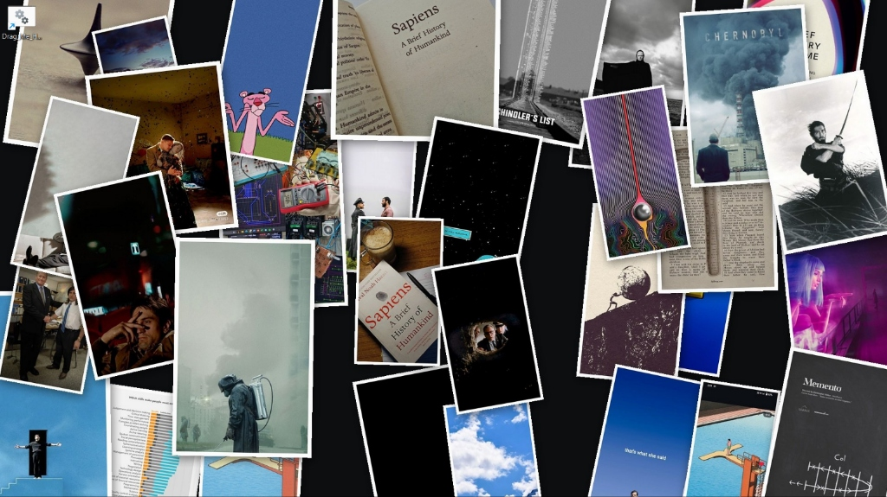
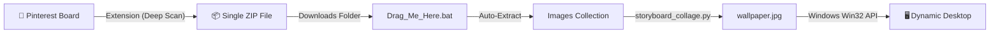

# 📌 PinBoard: Dynamic Storyboard & Moodboard Wallpaper

[](https://github.com/mohamedmeeranbuhari-hub/Pinboard-wallpaper)
[](https://github.com/mohamedmeeranbuhari-hub/Pinboard-wallpaper)
[](LICENSE)

> Transform your desktop into an evolving, organic vision board of your favorite Pinterest pins, memes, quotes, and artworks — with **0% continuous CPU or battery drain**.

> [!NOTE]
> 🛋️ **100% Vibe Coded (So You Don't Have To)**  
> Yes, this entire repository — from the Manifest V3 browser extension that outsmarts Pinterest's virtualized DOM to the Windows Win32 ctypes API hooks and PIL drop-shadow compositing math — was **entirely vibe coded**. We spent the time prompting, debugging, and fine-tuning every single edge case so you don't have to write a single line of code. Just clone, drop your pins, and enjoy.



---

## 💡 The Idea

Standard desktop wallpapers get boring quickly. Slideshows only show one photo at a time. What if your desktop could feel like an authentic, physical **storyboard or moodboard** — scattered with things you resonate with, constantly growing as you discover new inspiration on Pinterest?

**PinBoard** is a complete, lightweight suite that connects your Pinterest board directly to your Windows desktop background:
1. **Bulk Download Extension (Edge/Chrome Manifest V3):** Scrapes high-resolution pins from any board and downloads them in **a single `.zip` file** (bypassing browser download spam).
2. **Messy Storyboard Engine (Python):** Organically arranges all your pins with realistic drop shadows, gentle physical tilts, polaroid borders, and **zero cropping**.
3. **Zero-Battery-Drain Architecture:** No running background daemon or memory hog. The script executes in ~2 seconds on-demand and immediately exits.

---

## ✨ Features

- **📌 Organic Storyboard Scatter:** Stratified grid distribution with random jitter mimics an authentic artist's pinboard.
- **🖼️ 100% Content Preservation (Zero Cropping):** Never cuts off text, memes, tall book pages, or wide landscape art. Every image retains its original aspect ratio.
- **📐 Dynamic Scaling:** Automatically scales the photos depending on how many you have — whether you have 10, 32, or 100+ pins, they all fit seamlessly.
- **✨ Realistic Soft Shadows & Borders:** Individual Gaussian drop shadows give depth so overlapping prints feel tangible.
- **🚀 Custom Edge/Chrome Extension:**
  - Upgrades preview thumbnails (`236x`, `736x`) to uncompressed `/originals/` resolution.
  - Beats Pinterest's DOM virtualization by continuously accumulating pins in memory as you scroll.
  - Bundles pins into 1 ZIP file using client-side `JSZip`.
- **🔄 Auto-Unpack Pipeline:** Automatically detects newly downloaded ZIPs in your `Downloads` folder, unzips them into your collection, and updates your wallpaper with one click.
- **🍱 Bonus Bento Gallery Mode:** Includes an alternative Apple/editorial magazine style (`bento_collage.py`) with atmospheric ambient background lighting.

---

## 📁 Repository Structure

```text
├── assets/
│   └── desktop_preview.jpg     # Screenshot of the live desktop wallpaper
├── extension/                  # Chromium / Microsoft Edge Manifest V3 extension
│   ├── manifest.json           # Extension configuration
│   ├── popup.html              # Clean extension popup interface
│   ├── popup.css               # Styling
│   ├── popup.js                # Continuous DOM scraper & downloader
│   ├── jszip.min.js            # Client-side single ZIP packager
│   └── icon*.png               # Extension icons
├── storyboard_collage.py       # Main engine: organic scatter, scaling & shadows
├── bento_collage.py            # Alternate engine: editorial Bento box layout
├── wallpaper_setter.py         # Windows ctypes API wallpaper applicator
├── main.py                     # Entry point: handles sync, unzipping & refresh
├── Drag_Me_Here.bat            # Windows batch launcher (supports drag-and-drop)
├── requirements.txt            # Python dependencies (Pillow)
└── README.md                   # Documentation
```

---

## 🚀 Getting Started

### 1. Prerequisites
- **Operating System:** Windows 10 or Windows 11
- **Python:** Python 3.9+ installed and added to PATH
- **Browser:** Microsoft Edge, Google Chrome, or Brave

### 2. Setup the Wallpaper Engine
1. Clone this repository or download it to your preferred folder:
   ```bash
   git clone https://github.com/mohamedmeeranbuhari-hub/Pinboard-wallpaper.git
   cd Pinboard-wallpaper
   ```
2. Install the required Python dependency:
   ```bash
   pip install -r requirements.txt
   ```
3. Create a desktop shortcut for easy access:
   - Right-click `Drag_Me_Here.bat` → **Send to** → **Desktop (create shortcut)**.

### 3. Install the Edge / Chrome Extension
1. Open Microsoft Edge and go to `edge://extensions` (or `chrome://extensions` in Chrome).
2. Enable **Developer mode** (toggle in the bottom-left sidebar on Edge, top-right in Chrome).
3. Click **Load unpacked** and select the `extension/` folder inside this repository.
4. The **Pin Collector** icon will now appear in your browser toolbar!

---

## 🛠️ How It Works (Daily Workflow)



1. **Browse Pinterest:** Visit your board or search feed.
2. **Collect Pins:** Click the extension icon, choose your scan depth (e.g. `Deep Scan (~50 pins)` or `Full Board`), and click **Download as 1 ZIP**.
3. **Update Wallpaper:** Double-click the `Drag_Me_Here` shortcut on your desktop!
   - It automatically extracts the ZIP, adds new images, reshuffles the layout, and applies your new wallpaper in ~2 seconds.
4. **Drag & Drop:** You can also drag any image or ZIP file directly onto the `Drag_Me_Here` shortcut anytime.

---

## 🎨 Customization

You can tweak the aesthetic parameters in `storyboard_collage.py`:

| Parameter | Location | Description | Default |
| :--- | :--- | :--- | :--- |
| **Tilt Angle** | `angle = random.uniform(-14.0, 14.0)` | Maximum rotation range for prints | `±14°` |
| **Border Width** | `border_px = max(6, min(14, ...))` | White polaroid border thickness | Dynamic |
| **Shadow Blur** | `ImageFilter.GaussianBlur(radius=10)` | Softness of the physical drop shadow | `10px` |
| **Backdrop Color** | `canvas = Image.new(..., '#16171a')` | Background canvas color | Dark studio slate |

---

## 📄 License

This project is licensed under the [MIT License](LICENSE).
